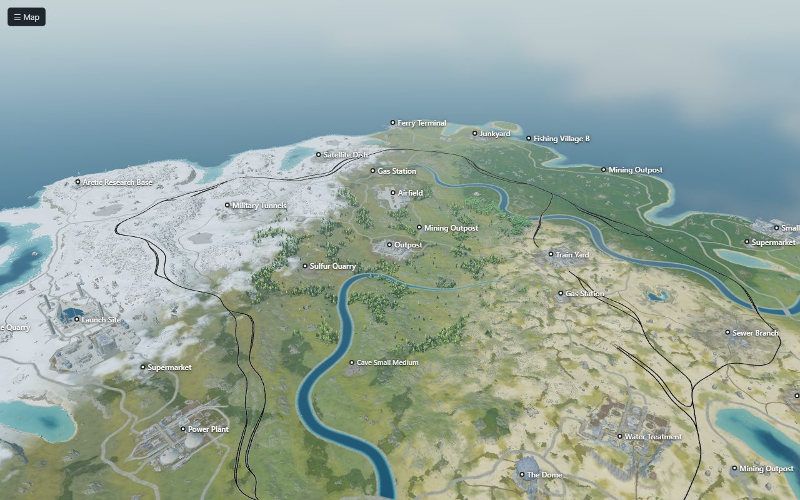
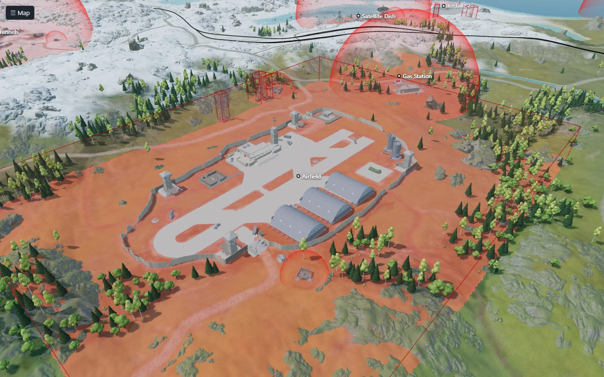
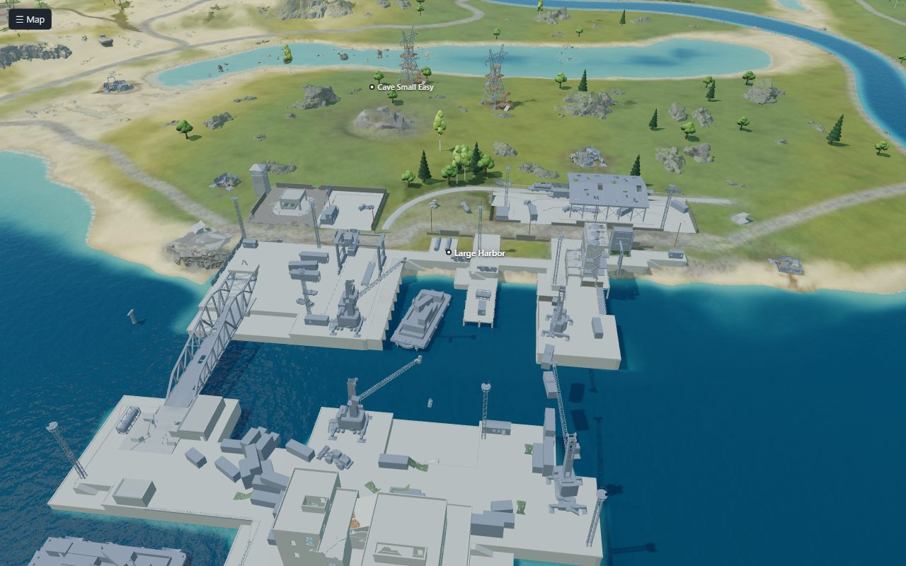

# RustMapGen

Make procedural maps for Rust on your own computer, with the game's own generator, and decide
what goes on them: which monuments, how much land, how high the hills, your own prefabs around
the Outpost or any other monument. A panel in your browser holds the settings, makes maps in a
queue, checks every map and shows it.

<picture>
  <source media="(prefers-color-scheme: dark)" srcset="docs/images/panel-map-dark.jpg">
  
</picture>

The maps are real procedural Rust maps, made by the official Rust dedicated server with a small
mod that steers its generator. They load on any server like a map from a map editor.

**In real use.** RustMapGen is the generator behind a network of public Rust servers, taken out of
it to run on its own. Every wipe there, about twenty a week, has run on one of its maps: made ahead,
checked and load-tested as described below, put to the players' vote, and served.

## What you need

- A 64-bit PC with **Linux** (x86-64) or **Windows 10/11**.
- **8 GB of memory** or more (a map uses about 5 GB while it is made).
- **About 7 GB of disk**: 6 GB for the Rust dedicated server, and 15 to 90 MB per map.
- **Python 3.9 or newer.**
  - Linux (Debian, Ubuntu): `sudo apt install python3 python3-venv lib32gcc-s1`
  - Windows: the installer uses the Python it finds; without one it tries to install it with
    winget. If that fails, install Python from [python.org](https://www.python.org/downloads/)
    with **Add python.exe to PATH** ticked.

Nothing of the game comes with this code: the installer downloads steamcmd and the free Rust
dedicated server from Steam.

## Install

**Linux**

```sh
git clone https://github.com/S1gil0/rustmapgen.git
cd rustmapgen
./install.sh
```

**Windows:** on GitHub, **Code → Download ZIP**, extract it, and double-click `install.cmd`.

The first install fetches the game (about 6 GB) and takes a few minutes. Each step is shown as it
starts, and the download as it goes (on Windows in steamcmd's own lines). Run the installer again
at any time to bring the game up to date.

## Start the panel

- Linux: `./rustmapgen.sh`
- Windows: double-click `rustmapgen.cmd`

The panel opens in your browser at http://127.0.0.1:5350. Keep its window open while you use it.

## Make your first map

1. Click **New Map**. It opens on the **Game default** preset: the map the game makes by itself.
2. Pick a preset under **Settings**, or change anything in the sections on the left.
3. Choose the **Size**, a **Seed** (empty for a random one) and how many **Maps**, then click
   **Make maps**.
4. Open **Maps** to watch it being made. A small map takes from 30 seconds to two minutes, a large
   one from two to six, depending on the computer.
5. The finished map shows **At a glance** (green, amber, red) and every check. **Load test** has
   the game's dedicated server, on your computer, load the finished file the way your server will
   (nobody joins it: it only checks the file). **3D ↗** beside it opens the map in 3D.
6. **Download .map** gives you the file.

<picture>
  <source media="(prefers-color-scheme: dark)" srcset="docs/images/panel-settings-dark.jpg">
  
</picture>

Settings you change can be kept with **Save as…** (in `data/recipes`); the presets themselves
never change. **Remove** takes saved settings, or a preset you do not use, off the list; **Game
default** always stays.

### Presets

| Preset | Size | What it is |
|---|---|---|
| Game default | 4250 | Nothing changed: the map the game makes by itself. From 4250 the game places every monument and both rings (rail and road) by itself. |
| Small, no safe zones | 2000 | A fighting map with 40 % land: no Outpost, Bandit Camp, fishing villages or ranches, few large monuments, no caves, building on roads allowed, a rail ring. |
| Medium | 3000 | 21 monuments wanted, the Outpost near the middle, 61 % land, a rail ring; no Bandit Camp, ranches, Radtown, jungle ruins, caves, swamps or wells. |
| Large | 4000 | The medium map with Radtown and the jungle ruins back, no canyons, and two or three underwater labs. |

The three samples also leave out icebergs, mountains, car wrecks and power poles along roads. Any
preset can be made at another size.

Maps made with the four presets, as the panel's **Picture** button gives them (click one to see it
whole):

<table>
<tr>
<td width="50%"><a href="docs/images/map-small.jpg"></a><br><b>Small, no safe zones</b> · 2000</td>
<td width="50%"><a href="docs/images/map-medium.jpg"></a><br><b>Medium</b> · 3000</td>
</tr>
<tr>
<td width="50%"><a href="docs/images/map-large.jpg"></a><br><b>Large</b> · 4000</td>
<td width="50%"><a href="docs/images/map-default.jpg"></a><br><b>Game default</b> · 4250</td>
</tr>
</table>

### Your own prefabs around a monument

Make a small map in a map editor (such as RustEdit) with one of the game's monuments and your
prefabs around it: recyclers, vendors, decorations. Add it under **New Map → Custom prefabs →
Add template** and tick it. How it works:

- **The monument is found by itself.** RustMapGen looks for the one game monument in the file (the
  Outpost, the Bandit Camp, a harbor, a gas station…) and ties the template to it; a file with no
  monument, or with two, is refused. The panel names it once your first map is made (the game's list
  of prefabs comes with it).
- **Your prefabs keep their place around it.** Each one is kept by its distance, height and turn from
  the monument, and put back the same way on every new map, turned as the monument is turned there,
  on every copy of it (gas stations and fishing villages can come more than once). Each variant is a
  monument of its own: Harbor 1 and Harbor 2, or Fishing Village A, B and C, need a template each.
- **Only prefabs are taken.** Terrain height, paint, topology and roads in the file are not. Prefabs
  the game does not know (editor-only objects) are left out and counted; ones Facepunch has since
  moved to another folder (the Hapis vending machines of many Outpost templates) are found where they
  are now. **Leave out of templates** drops prefabs whose path holds a word you give, such as
  `snowmobilespawner`.
- **One template per monument.** Two around the same monument would land on top of each other:
  ticking one unticks the other, and settings that name two are refused.
- **Checked on every map.** The map's page lists each template with the copies found and the prefabs
  placed, and a check passes only when every copy holds all of its template's prefabs where they
  belong. **Load test** then shows the game loads them.

## Every map is tested

A map is checked as soon as it is made, on the file a server would load, in three layers:

- **Can it be played:** what any map must show. The rail ring is closed with nothing cut off from it,
  the rails are not too steep and stay above the water, sea and land are tagged as the heights say,
  monuments and power line towers stand on the ground, and every tunnel entrance leads into the
  tunnels. A monument stands on the ground only when all the ground it levels for itself is where it
  usually is: a neighbour placed after it can cut part of it down or raise it, leaving one end in the
  air.
- **Is it what was asked:** your settings, checked against the result. The monuments you wanted are
  there and the ones you blocked are not, the land is the share you asked for, the rail ring and the
  Outpost are as you set them, and your templates were merged whole.
- **Does the game load it:** **Load test** has the dedicated server, on your computer, load the
  finished file the way your server will, and reads its log: what it loaded, and anything that went
  wrong.

**At a glance** on each map's page sums it up in green, amber or red, and **passing only** over the
list of maps hides the ones that failed a check. A failed check deletes nothing: see what failed,
keep the map or make another seed.

<picture>
  <source media="(prefers-color-scheme: dark)" srcset="docs/images/checks-dark.png">
  
</picture>

## See a map in 3D

**3D ↗** on a map's page opens the whole map in 3D, in a tab of its own: the ground, the sea, rivers
and lakes, roads and rails, trees, and the monuments, cliffs, rocks, ice, power line pylons,
substations and tunnel entrances where the game will stand them. **No-build zones** shows in red
where the game will not let a base be built. Drag to turn, the wheel to zoom, W A S D to fly.



<table>
<tr>
<td width="50%"><a href="docs/images/3d-airfield.jpg"></a><br><b>No-build zones</b> · Airfield</td>
<td width="50%"><a href="docs/images/3d-harbor.jpg"></a><br><b>Large Harbor</b></td>
</tr>
</table>

**How the monuments are made.** RustMapGen ships no model of the game. The dedicated server it
installs keeps few of the parts the game draws, but every solid collider: the walls, floors, roofs,
towers and rock faces players stand on and bump into. RustMapGen reads those from the server's files
in `game/`, keeps the structures of each monument (objects at least 6 m across, without rubble or
litter), colours each piece by the surface the game gives it (metal, concrete, wood, rock…) and thins
it to a budget of triangles, with a lighter copy for when it is far away. The no-build zones come
from the same files: they are the game's own volumes that stop a base being built.

This runs by itself, once for each build of the game: right after the installer installs the game,
after every update of the game, and when the panel starts without the models. It takes a few
minutes and about 2.5 GB of memory, and keeps about 30 MB in `data/3d-models/`; until then the view
shows the ground alone. If it fails, the map's page says so and **Prepare 3D** tries again. Reading
the game's files needs [UnityPy](https://github.com/K0lb3/UnityPy), which is installed into
RustMapGen's Python the first time (without the texture and sound decoders it would otherwise bring).

**How the map is drawn.** Everything else comes from the map file: its heights, the sea, rivers and
lakes, the colour of the ground, roads, rails and power lines, and where each monument, cliff and rock
stands. The first time a map's 3D view opens, RustMapGen turns these into a few files beside the map
(seconds), and your browser draws the whole map with [three.js](https://threejs.org/). A map file
holds no trees (the game plants them when a server starts), so the trees are scattered from the map's
forests and are approximate.

The models are made and kept on your computer, in your data folder, and like the game they are
Facepunch's. RustMapGen sends them nowhere; the browser that opens the panel loads them from it, so a
panel opened from another computer ([see below](#use-the-panel-from-another-computer)) hands them to that one too.

## Put a map on your server

A server, and every player who joins it, downloads a custom map from an address:

```
+server.levelurl "https://your.host/path/your-map.map"
```

The address must be **HTTPS** (the game refuses plain HTTP) and serve the file as it is. With a
`levelurl` the server ignores its seed and size settings. Give every map an address of its own and
never put other bytes under it: the game keeps a downloaded map by its name. The map names the panel
gives are never repeated, so `<name>.map` makes a good address.

### The simplest: mapstr.gg

[mapstr.gg](https://mapstr.gg/) hosts Rust maps for free, with no account: get the file with
**Download .map**, upload it on their page (up to 100 MB a map), and put the direct link they give
you in `+server.levelurl`. Make sure the link starts with `https://`. Signing in there with Discord
lets you see and delete your uploads.

### Many maps, by script: Cloudflare R2

[Cloudflare R2](https://developers.cloudflare.com/r2/) is a proven home for maps when you make many or
want them uploaded by a script: free at this scale (10 GB of storage, a million uploads and ten
million downloads a month, and nothing charged for data sent out:
[R2 pricing](https://developers.cloudflare.com/r2/pricing/)), served from Cloudflare's network near
your players, and filled from the command line.

1. In the Cloudflare dashboard, make an R2 bucket and connect a domain of yours to it (the bucket's
   **Settings → Custom Domains**). Its `r2.dev` address is fine for a test but rate-limited: use your
   own domain for a server.
2. Make an R2 API token with **Object Read & Write** on that bucket and give it to
   [rclone](https://developers.cloudflare.com/r2/examples/rclone/) (`rclone config`, provider
   Cloudflare).
3. Upload a map from `data/maps/<name>/` and point the server at it:

```sh
rclone copyto data/maps/<name>/final.map r2:<bucket>/<name>.map
```
```
+server.levelurl "https://maps.example.com/<name>.map"
```

Every finished map in one go (a map already in the bucket is left as it is):

```sh
for map in data/maps/*/final.map; do
  rclone copyto --ignore-existing "$map" "r2:<bucket>/$(basename "$(dirname "$map")").map"
done
```

Cloudflare caches only some kinds of files by itself: a cache rule that caches everything on that
domain has players served from its cache, with the bucket read about once per Cloudflare location.

## Updates

**Updates**, at the top right of the panel, keeps both parts up to date:

- **RustMapGen:** **Check for updates**, then **Update to …** (**What is new** opens the
  [changes](CHANGELOG.md)). Your maps, settings and the game stay as they are; a copy cloned with git
  is updated with git, a copy from a ZIP gets the new files, and the panel starts again by itself.
- **The game:** **Check** asks Steam for its newest build, and **Update the game** brings it there.
  Maps wait in the queue while it updates.

Rust updates on the first Thursday of the month. The mod that comes with RustMapGen usually keeps
working; if maps stop being made after an update ("the game did not load the mod"), check for a
RustMapGen update. From the command line, `./rustmapgen.sh update` updates the game, and with the
[.NET SDK 8](https://dotnet.microsoft.com/download) or newer `./rustmapgen.sh build-mod` builds the
mod against the game you have.

## The forced wipe

The monthly Rust update reaches players on the first Thursday of the month, the forced wipe, and it
is the update that changes how maps are made. From that day on, a game last updated before it is
brought to that update before the next batch of maps, once Steam has it: Steam's public branch set
to a build on that day (UTC). Asking takes seconds, and an answer is used again for half an hour
(when Steam does not answer, the next map asks again). Until the update is out, and when Steam
cannot be asked, the maps are made on the game you have.

Only a game older than the wipe is updated by itself: an update later in the month is yours to make
(**Updates → Update the game**). A game updated on the Thursday before the update came out counts
as current: update it once more when Steam has the new build. From the command line the same step
runs before `generate`, or alone as `./rustmapgen.sh update --forced-wipe`.

## Maps for the next update

The forced wipe's update changes how maps are made, and before it is out a Steam branch of the
dedicated server already holds it. Which branch, and when its maps are final, the RustMapGen authors
check by hand: they make the same maps on each new build and compare them. Once the maps of the update
are final, a **RustMapGen update** declares it (**Updates → Check for updates**). From then on:

- **What changes** opens once by itself, and again from the links beside the choice: the changes in
  the maps, in plain words, with the day the authors checked them.
- **New Map** shows **Game: Public / Next update**, with the days left to the wipe, until the update
  is out. Without such an update of RustMapGen nothing of it shows.
- **A game of its own.** These maps are made on a second copy of the game (`game-next/`, about
  6 GB), brought to Steam's newest build of that branch before each batch and each load test. Public
  maps can still be made those days. If the authors correct the next update later, maps made before
  say so, until the update is out (from then on what counts is the load test on the released game).
- **The release is read on Steam,** not on a clock (its hour moves, and with summer time). On the
  Thursday, every map of the next update first asks Steam whether the update is out (an answer is
  used again for half an hour): Steam says its public branch was set to a new build that day, or
  that branch holds the declared branch's build. From then on the choice closes, and maps are made
  on the public game, brought to the update first (see [The forced wipe](#the-forced-wipe)). Maps of
  the next update still waiting then are not made: make them again on the public game. If Steam
  does not answer that day, RustMapGen waits rather than guess. At the latest, it closes when the
  Thursday ends (UTC).
- **Marked.** These maps carry a **Next update** badge with their build. **After the release**, such
  a map asks for a **Load test** on the released game: the public game is first brought to Steam's
  newest build (at any time: such a test may fetch a later update too), then loads the map as your
  server will. A test counts as on the released game when the public game it ran on was updated on
  or after the day of that forced wipe (UTC).
- **When the mod does not load** on that build (the game changed too much), the panel says so and no
  more maps are tried on it; **Check for updates** brings a RustMapGen with a mod that does, when
  there is one.
- **Afterwards**, **Updates → Next update → Remove** deletes its game. Your maps stay.

```sh
./rustmapgen.sh update --game next                    # its game, once an update of RustMapGen declares it
./rustmapgen.sh generate --recipe large --game next
./rustmapgen.sh load-test <map name> --game next
./rustmapgen.sh remove-next
```

## From the command line

Everything the panel does (`rustmapgen.cmd` on Windows):

```sh
./rustmapgen.sh generate --recipe large --count 3          # a preset, a saved setting or a .json file
./rustmapgen.sh generate --recipe small --seed 12345 --size 2500
./rustmapgen.sh load-test <map name>
./rustmapgen.sh models-3d                                  # the 3D view's monuments and rocks (made by themselves too)
./rustmapgen.sh list
./rustmapgen.sh doctor                                     # what this computer has
./rustmapgen.sh finish-update                              # an update of RustMapGen that stopped half way
```

## Use the panel from another computer

Start it with `./rustmapgen.sh panel --host 0.0.0.0` and open the `http://` address it prints
(not `https://`). The panel has no password: anyone who can reach the computer can then make and
delete maps, and update RustMapGen and the game (only ever from their official sources). Do this on
a network you trust only; from anywhere else, reach it through an SSH tunnel
(`ssh -L 5350:127.0.0.1:5350 you@that-computer`, then http://127.0.0.1:5350), and never open it to
the internet. The panel answers this computer's addresses and names only; to reach it by another
name, add it to `panel_hosts` in `data/settings.json`.

## Settings

Optional, in `data/settings.json`:

| Setting | Default | |
|---|---|---|
| `panel_port` | 5350 | the panel's port |
| `panel_hosts` | `[]` | more names the panel answers to |
| `min_free_gb` | 5.5 | free memory needed to start a map |
| `max_temp_c` | 85 | no map starts while the CPU is this hot (Linux; it waits for it to cool) |
| `timeout_minutes` | 45 | a map that takes longer is stopped |
| `isolate_network` | true | Linux: run the game with no network at all, where the system allows it |
| `game_port` | 28715 | ports the generator's game uses on 127.0.0.1 |

`RUSTMAPGEN_GAME` and `RUSTMAPGEN_DATA` move the game and the data to other folders (the game to an
empty folder of its own).

## Troubleshooting

| You see | Do this |
|---|---|
| "Python 3.9 or newer is needed" | Install Python (see [What you need](#what-you-need)), then run the installer again. |
| "steamcmd needs the 32-bit C library" | `sudo apt install lib32gcc-s1`, then run the installer again. |
| The panel does not open from another computer | Start it with `--host 0.0.0.0` and use `http://`, not `https://`. |
| "the game did not load the mod" | After a Rust update: **Updates → Check for updates**, or `./rustmapgen.sh build-mod` (needs the .NET SDK). |
| "the mod does not work on … build … yet" | The game changed something the mod relies on: **Updates → Check for updates**; a newer RustMapGen brings a mod that works, when there is one. |
| "the game's own map generation stopped with an error" | The game itself cannot make that seed at that size: make another seed or size. |
| "GB of memory free, … needed" | Close other programs; a map needs about 5 GB. |
| "the last update of the game did not finish" | **Updates → Update the game** again, or `./rustmapgen.sh update`. |
| A map fails a check | It is still a map: look at what failed, keep it or make another seed. |
| On Windows the window stops moving and its title starts with "Select" | A click in it started a selection, which pauses it: press Esc. |

## Good to know

- **Never put the mod on a server people play on**: a server that loads it quits instead of
  opening. RustMapGen keeps the game in a folder of its own (`game/`) and refuses to work in a
  folder that holds another server.
- The game is only run to make and test maps: it is bound to 127.0.0.1, quits before it would
  open to players, and the mod keeps it from uploading the map or its picture. On Linux it also
  runs with no network at all where the system allows it (each run says when it does not).
- Maps are made on the public game build; before a forced wipe also on the next update, once an
  update of RustMapGen declares it (see [Maps for the next update](#maps-for-the-next-update)).
- The same seed gives the same land on every computer, but monuments can land elsewhere.
- Some monuments need their biome (the Excavator the desert, the Ziggurat the jungle): with that
  biome at 0 % the game finds no room for them. The panel marks them.
- "Island size" moves the shore by 20 m at most, so 70 % land is the most a setting may ask.
- The map's picture has 600 m of sea around the square: the game puts the oil rigs out there.
- Windows reports no CPU temperature, so the temperature limit works on Linux only.

## How it works

The settings become the game's own world configuration and a job for the mod. The runner starts
the dedicated server with the mod; the mod shapes the land, places the monuments as asked and quits
once the map is saved. The map is then moved to `data/maps/<name>/`, your templates are merged in,
and it is described, checked and drawn. Its 3D view is made from the map file the first time it is
opened, beside the map's other files.

## License

MIT: see [LICENSE](LICENSE). It covers this code only; the Rust dedicated server the installer
fetches is Facepunch's, under its own terms, and so are the 3D view's models made from it. The 3D
view draws with [three.js](https://threejs.org/) (MIT, its notice in
`rustmapgen/page3d/viewer/vendor/three.LICENSE`).
